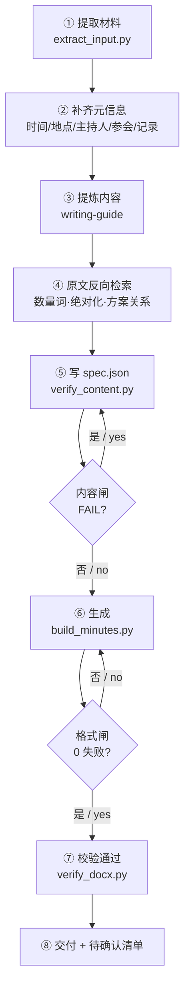

# sxg-meeting-summary

> 把会议原文 + AI 摘要，整理成**严格对齐 WMS 周会标准**的正式 Word 会议纪要。
> Turn messy meeting transcripts + AI summaries into **WMS-standard formal meeting-minute DOCX**.

[](LICENSE)


---

## 这是什么 · What it is

**中文** — 一个 WorkBuddy Skill。给定会议纪要（AI 摘要）和/或会议原文（逐字转写），它用**自带母版深拷贝**生成格式合规的 `.docx`，并通过 **「双闸」校验**保证内容准确、版式合规，最后输出一份待确认清单。

**English** — A WorkBuddy skill. Given a meeting summary (AI digest) and/or the verbatim transcript, it **deep-copies a built-in template** to produce a format-compliant `.docx`, then runs a **dual-gate check** to guarantee both accuracy and layout compliance, and finally emits a "to-be-confirmed" list.

核心特点 / Key features:

- **不手写任何样式** · No hand-written styles — all paragraphs and table rows are deep-copied from the template; only text is replaced.
- **标准三段式** · Standard 3-part layout: 红色仿宋大标题、元信息五行、会议目的 / 核心议题与决策 / 行动项表格、右对齐落款。
- **自动还原** · Auto-recovery: 还原发言人真名、从口语推断会议日期与地点、抽取行动项责任人与优先级。
- **双版本并存** · Dual deliverables: 归档用 `docx` + 阅读用分条版 `markdown`。

---

## 为什么要「双闸」· Why the dual-gate


**中文** — 只做格式校验（像不像正式文件）不够：格式全绿，也可能把「排版工整的错误结论」交给领导；只做内容校验（说得对不对）也不够：内容正确但排版不合规，同样不能归档。两道闸各管一端，**缺一不可**。

**English** — A format check alone (does it *look* official?) is insufficient: a document can pass all 23 layout checks yet still carry wrong conclusions. A content check alone (is it *correct*?) is insufficient: correct content in a non-compliant layout cannot be archived. The two gates cover different ends — **neither substitutes for the other**.

| 闸 / Gate | 脚本 / Script | 管什么 / What it checks | 失败处理 / On failure |
|---|---|---|---|
| **内容闸** Content Gate | `scripts/verify_content.py` | 分句 ≤4、字数 ≤150、结构完整、三类断言（数量词 / 绝对化 / 方案关系）、决策事项含责任人 | **FAIL 阻断**：必须改 `spec.json`，不得带着 FAIL 生成 |
| **格式闸** Format Gate | `scripts/verify_docx.py` | A4 与页边距、标题字体字号颜色、元信息五行、编号缩进、表格列宽、落款对齐 | **0 失败**才算完成，否则修正格式 |

> **经验证据** · Evidence: 2026-10-28 一份纪要 23 项格式校验全通过，仍被退回重排——因为关键结论是含六层信息的分号长句；补做内容闸后逐条回溯才修正。 / A minutes document once passed all 23 format checks yet was still sent back for rework because its key conclusion was one overloaded semicolon sentence — only the content gate caught it.

---

## 原文反向检索 · Reverse-search from the verbatim transcript


**中文** — 结论只能从**原文逐字稿**取，不许从 AI 摘要转写（摘要有损压缩，会丢掉数量、例外、关系）。写 `spec.json` 之前，对每条结论做三类核对：

1. **数量词**（N 次 / N 处 / 全部 / 均）→ 在原文 grep 关键词计数；
2. **否定与绝对化表述**（不能做 / 无法实现）→ 同时检索该发言人是否给过例外或让步（「可以」「但前提」「除了」）；
3. **方案间关系**（并列 or 递进）→ 「A 否则 B」多为递进，不是并列。

产出证据表 `主张 | 时间戳 | 原话摘录`；**未能在原文定位的主张，不得进入 spec**。

**English** — Conclusions must come from the **verbatim transcript**, never from the AI summary (summaries are lossy — they drop counts, exceptions, and relations). Before writing `spec.json`, cross-check every conclusion in three ways: (1) count quantity words via grep; (2) for negations/absolutes, check whether the speaker gave any exception; (3) distinguish parallel vs. progressive relations between options. Output an evidence table `claim | timestamp | verbatim quote`; claims not locatable in the transcript must not enter the spec.

---

## 快速开始 · Quick Start

### 1. 安装依赖 · Install dependencies

```bash
python -m pip install python-docx pdfplumber   # pdfplumber 可选 / optional
python scripts/check_environment.py            # 环境自检 / self-check → ready
```

### 2. 工作流 · Workflow（8 步 / 8 steps）



### 3. 最小示例 · Minimal example

```bash
# 提取纪要文本与原文发言人
python scripts/extract_input.py 纪要.md    --output 纪要.txt
python scripts/extract_input.py 原文.docx  --output 原文.txt --speakers

# 写 spec.json（参考 assets/spec.example.json），再跑双闸
python scripts/verify_content.py spec.json   # 内容闸：FAIL 0 才能继续
python scripts/build_minutes.py spec.json    # 生成 docx（已存在则退出码 3，需删旧文件或 overwrite）
python scripts/verify_docx.py 生成的.docx    # 格式闸：0 失败才算完成
```

---

## 目录结构 · Repository structure

```text
sxg-meeting-summary/
├── SKILL.md                      # 技能定义与流程 / skill definition & flow
├── skill-dependencies.json       # 依赖声明（python-docx / pdf-extractor）
├── assets/
│   ├── template_standard.docx    # 母版（固化格式，深拷贝源）/ template
│   ├── spec.example.json         # spec.json 完整示例 / example spec
│   └── README-*.png              # 本 README 配图 / illustrations
├── references/
│   ├── style-spec.md             # 格式规格与母版索引 / layout spec
│   ├── writing-guide.md          # 内容提炼、分句上限、反向检索 / writing rules
│   ├── kickoff-prompt.md         # 开工提示词模板（6 条硬约束）
│   └── setup-guide.md            # 依赖安装与故障恢复 / setup & recovery
└── scripts/
    ├── check_environment.py      # 环境自检 / self-check
    ├── extract_input.py          # 提取 PDF/DOCX/TXT/MD，--speakers 统计发言人
    ├── verify_content.py         # 内容闸 / content gate
    ├── build_minutes.py          # 由 spec.json 生成 docx
    └── verify_docx.py            # 格式闸 / format gate
```

---

## spec.json 字段 · Spec fields

| 字段 / Field | 类型 / Type | 说明 / Notes |
|---|---|---|
| `template` | string | 母版路径；省略则用自带母版 |
| `output` | string | 输出 docx 路径（相对 spec 所在目录解析） |
| `overwrite` | bool | 目标存在时是否覆盖；默认拒绝（退出码 3） |
| `meta` | object | `time` / `place` / `host` / `attend` / `recorder` |
| `purpose` | array | 会议目的条目，自带「N.」前缀，3—5 条 |
| `summary` | string | 综述段（一段） |
| `topics` | array | 每项含 `title` / `conclusion` / `decision` |
| `actions` | array | 每项含 `no` / `content` / `owner` / `priority` |
| `action_title` | string | 行动项标题，默认「三、 行动项 (Action Items)」 |
| `include_supplement` | bool | 是否输出「四、 补充说明」，默认关闭 |
| `supplement` | string | 补充说明正文（**不要带「四、 补充说明：」前缀**） |
| `sign_date` | string | 落款日期，形如「2026年09月29日」 |

完整示例见 [`assets/spec.example.json`](assets/spec.example.json)。

---

## 输出格式 · Output format

生成的 `.docx` 严格对齐 WMS 周会标准：

1. **大标题**「会 议 纪 要」— 仿宋_GB2312，48 磅，加粗，红色（FF0000），居中；
2. **元信息五行** — 会议时间 / 会议地点 / 主 持 人 / 参会人员 / 记 录 人；
3. **一、会议目的** — 3—5 条动宾短句；
4. **二、核心议题、关键结论与决策** — 综述 1 段 + 议题 3—6 个（每个含关键结论 + 决策事项）；
5. **三、行动项** — 表格（序号 / 行动内容 / 责任人 / 优先级），一行一件事；
6. **四、补充说明**（可选）— 默认关闭；
7. **落款** — 右对齐日期。

> 所有段落与表格行均从母版深拷贝，仅替换文字，不手写任何样式。 / Every paragraph and table row is deep-copied from the template; only text is replaced.

---

## 依赖 · Dependencies

| 依赖 / Dependency | 必需 / Required | 用途 / Use | 安装 / Install |
|---|---|---|---|
| Python ≥ 3.10 | 必需 | 运行全部脚本 | 官网下载 / python.org |
| `python-docx` | 必需 | 读母版、生成与校验 docx | `pip install python-docx` |
| `pdfplumber` / `PyPDF2` / `pymupdf` | 可选 | 提取 PDF 文本（任一可用即可） | `pip install pdfplumber` |

本技能**不联网、不登录、不需要任何凭据**。 / This skill runs fully offline and requires no credentials. 详见 [`references/setup-guide.md`](references/setup-guide.md)。

---

## 许可 · License

[MIT](LICENSE) © 2026 huangluke89757
